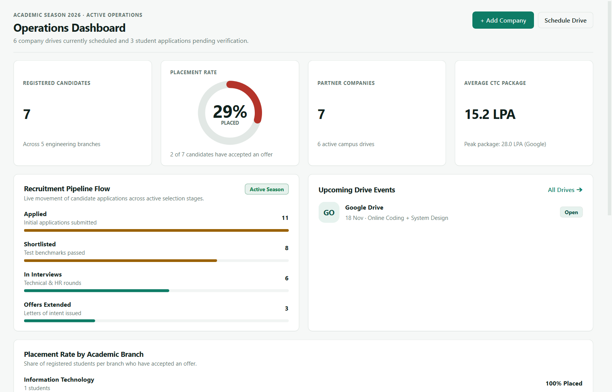
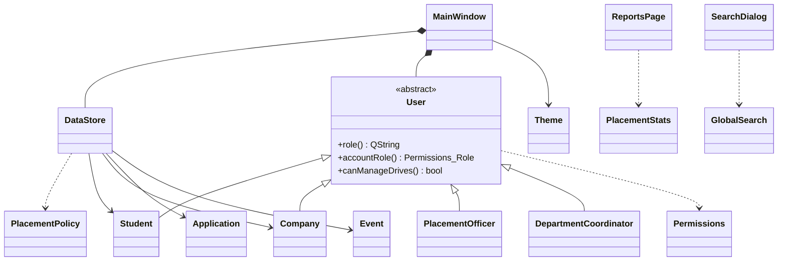

# PlaceBridge

Native Qt 6 Widgets campus placement management app (C++17); no web UI.
Built as a B.Tech object-oriented programming project: four user roles, SQLite
persistence, role-based permissions and a test suite.

## Features

- Four roles: Admin (placement office), Department Coordinator, Recruiter, Student.
- Drive management with approval workflow, status filters, search and sorting (by package or company), eligibility rules (CGPA, backlogs, branch,
  batch, offer limits, Regular / Dream / Super Dream tiers).
- Applications pipeline, interview calendar with conflict detection, offer accept/decline.
- Student profile, document vault with admin verification, CSV bulk import/export.
- Reports page with real analytics (placement rate, placed students by branch,
  package brackets, top recruiters) and PDF / XLSX / CSV export.
- **Global search** (`Ctrl+K`) across students, drives, applications and events; it only
  returns records the signed-in user is allowed to see.
- **Reminders**: when an admin signs in, applicants are notified about drives and events
  in the next 2 days (never sent twice).
- **Password recovery without a mail server**: the placement office issues a 15-minute
  one-time code (Settings -> Issue reset code); the user redeems it via *Forgot password?*.
- **Demo-password nudge**: users still on a documented demo password are prompted to change it.
- Accessibility: tooltips and accessible names on the navigation, notifications and account buttons.
- Welcome landing page with live student, hiring-partner and open-drive counts; responsive, role-aware sign-in and registration remain connected to the existing `DataStore`.
- Responsive layouts: selected navigation states, stacked cards and forms, narrow-screen calendar agenda, and vertically scrolling pages.
- Security: PBKDF2-SHA-256 hashes, per-user salts, constant-time comparison, login lockout,
  audit log, permissions enforced in `DataStore`.

## Build and run
Install Qt 6 with Widgets, Sql, PrintSupport, Network, CorePrivate,
and a C++17 compiler. From the project root:

```powershell
cmake -S . -B build -DBUILD_TESTING=ON
cmake --build build --config Release
ctest --test-dir build --output-on-failure
.\build\PlaceBridge.exe
```

Runtime SQLite database and log are under Qt's per-user `AppDataLocation`.

## Placement workflows

- Admin: approve recruiter-posted drives, verify profiles/documents, manage accounts,
  announce placement updates, review audit activity, and export reports.
- Department Coordinator: view only the assigned branch's students and post notices
  only to that branch. Admins create coordinator and additional Admin accounts in Settings;
  these privileged roles cannot self-register on the login page.
- Recruiter: post a role with a description, eligibility, and selection rounds;
  review candidates, move application stages, keep interview scorecards, and save
  a shortlist e-mail draft.
- Student: review eligibility and role details, manage profile documents, book
  interview events, give drive feedback, and accept or decline offers.
- Student Resume Studio: edit a multi-section resume, preview Modern / Classic / Minimal layouts,
  save it locally and export a template-matched PDF.
- Application, interview conflict, drive approval, notification, and account
  permissions are checked in `DataStore`, not just in page visibility.

## Optional REST server

The server is disabled by default. Configure and build it with:

```powershell
cmake -S . -B build\rest -DBUILD_REST_SERVER=ON -DBUILD_TESTING=OFF
cmake --build build\rest --target PlaceBridgeServer
.\build\rest\PlaceBridgeServer.exe
```

It binds to `127.0.0.1:8080`; `/api/health`, token login, `/api/me`, `/api/drives`,
`/api/applications`, and logout are available. Settings can use it for local
sign-in and test its health endpoint. The desktop's placement data still comes
from its configured SQLite store; this REST mode is not a remote data-sync or
production multi-host deployment. Do not expose the HTTP server to a network.

### Request flow (10 lines)

1. The Qt Widgets application starts with `MainWindow`.
2. `MainWindow` owns a `DataStore` and the polymorphic user session.
3. Login verifies credentials locally by default.
4. Optional local REST sign-in obtains a short-lived bearer token.
5. The REST server validates credentials against its SQLite database.
6. `/api/me` returns the authenticated account identity and role.
7. Role permissions are enforced again inside `DataStore`.
8. The desktop UI continues to load and save through its local `DataStore`.
9. `DataStore` uses prepared QtSql queries and emits `changed()` after writes.
10. Future multi-host deployment needs a remote `DataStore` adapter and HTTPS.

## Demo accounts

| Role | E-mail | Password |
|---|---|---|
| Admin | officer@placebridge.edu | admin123 |
| Student | rahul.sharma@placebridge.edu | student123 |
| Recruiter | recruiter@accenture.com | recruit123 |

Passwords are stored as salted PBKDF2-HMAC-SHA-256 hashes. Change demo passwords
before using this application with real personal data.

## Screenshots

Run the app, then save three screenshots with these exact names (see
`docs/screenshots/README.md`) and they will appear below.





## Class diagram



## OOP concepts

| Concept | Implementation |
|---|---|
| Abstraction | `DataManager.h`: abstract `User::role()` and `User::accountRole()` |
| Inheritance | `student/student.h`, `company/company.h`, `placement_officer/placement_officer.h` |
| Polymorphism | `mainwindow.h`: role-specific `std::unique_ptr<User>` session; `User::canManageDrives()` etc. answer per object via the overridden `accountRole()` |
| Encapsulation | `DataManager.h`: SQLite persistence/permissions |
| Composition | `mainwindow.h`: owns data store, pages and session |

## Windows deployment

From a Qt MinGW command prompt, after building Release (adjust Qt version and kit):

```powershell
cmake -S . -B build\release -DCMAKE_BUILD_TYPE=Release -DBUILD_TESTING=OFF
cmake --build build\release --config Release
C:\Qt\6.11.1\mingw_64\bin\windeployqt.exe --release --compiler-runtime --dir PlaceBridge-standalone build\release\PlaceBridge.exe
```

The program uses the Qt SQLite driver; `windeployqt` should include the
`sqldrivers\qsqlite.dll` plugin. Test the copied folder on a machine without Qt.
An optional Inno Setup script is in `installer/PlaceBridge.iss`; run it with
Inno Setup after creating `PlaceBridge-standalone`.

## Tests

`ctest --test-dir build --output-on-failure` runs `tests/test_placebridge.cpp`
(QtTest): domain classes, validators, eligibility boundaries, permissions
(string API vs. polymorphic API), analytics, reset codes, lockout, demo-password
detection, reminders, permission-aware search and the full SQLite workflow.
Warnings (`-Wall -Wextra` / `/W4`) are on by default; turn off with `-DENABLE_WARNINGS=OFF`.

## Known limitations

- `DataStore` is still one large header-only class. Password hashing has been
  extracted into `PasswordHasher`; moving drives, applications and accounts into
  separate repository classes is the next planned refactor.
- Students can withdraw and re-apply to a drive without a cool-down period.
- Translations are not shipped (the previous empty `.ts` placeholders were removed).

## Documentation

- `docs/PROJECT_REPORT.md` - abstract, objectives, modules, database design, OOP mapping, testing, future scope.
- `DEMO_SCRIPT.md` - step-by-step demo for a viva or presentation.

## Contributing

Use imperative commit subjects with a scope where useful, e.g.
`feat(students): add paged candidate registry` or `fix(auth): enforce lockout`.
Keep changes focused and run the QtTest suite before opening a PR.
