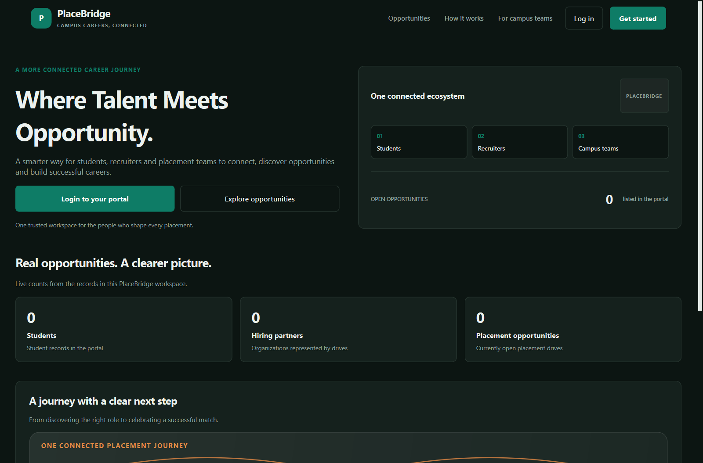
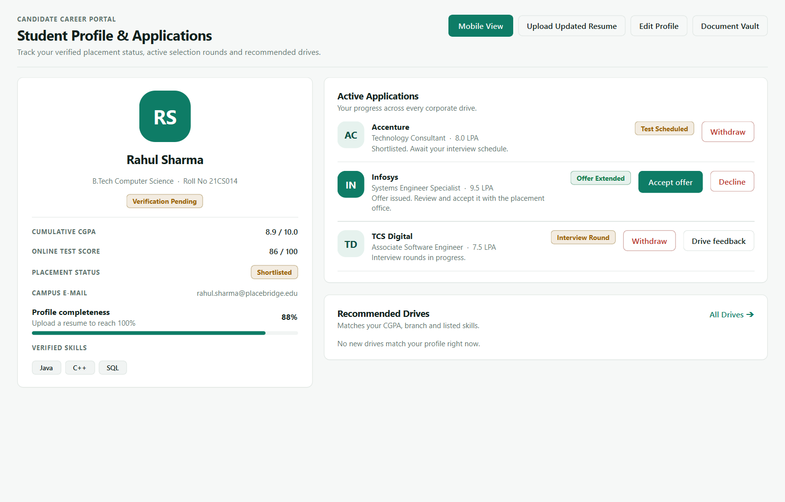
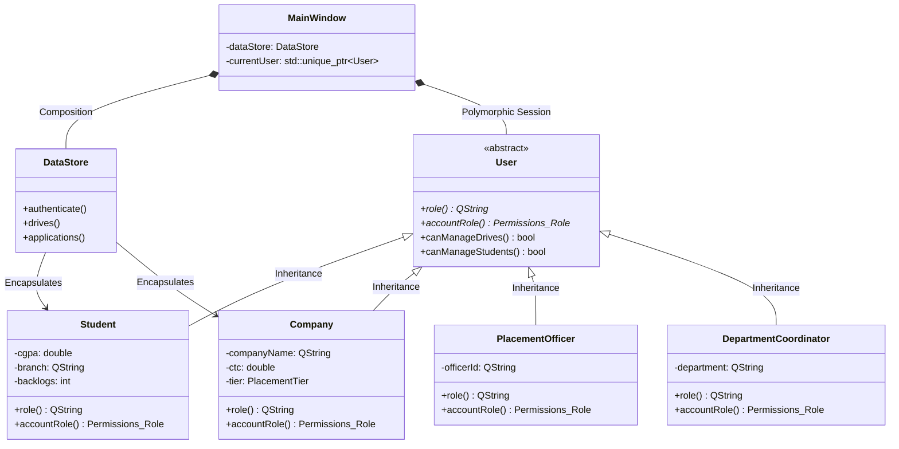

# PlaceBridge 🎓
> **Modern Native Campus Placement Management System**  
> *Built with C++17, Qt 6 Widgets, and SQLite — Engineered with core Object-Oriented Programming (OOP) principles.*

---

[](https://en.cppreference.com/w/cpp/17)
[](https://www.qt.io/)
[](https://cmake.org/)
[](https://www.microsoft.com/windows)
[]()

---

## 📌 Overview

**PlaceBridge** is an enterprise-grade desktop application designed to bridge the gap between academic institutions, students, and corporate recruiters during campus placement drives. 

Developed as an Object-Oriented Programming (OOP) project, PlaceBridge provides an end-to-end recruitment pipeline with strict role-based access control, real-time analytics, automated eligibility validation, conflict-aware scheduling, and an integrated Resume Studio.

---

## 🖼️ Application Preview

<div align="center">

### 1. Welcome & Authentication Portal
*Role-aware landing with live institutional metrics & secure authentication*


<br/>

### 2. Placement Officer (Admin) Dashboard
*Complete drive oversight, candidate approval pipelines, company verification & analytics*


<br/>

### 3. Student Portal & Opportunity Hub
*Personalized drive discovery, tier-based eligibility tracking, interviews & application status*


</div>

---

## ✨ Key Features & Capabilities

### 👥 1. Role-Based Access Control (4 Roles)
- **Placement Office (Admin)**: Approve recruiter drives, verify student credentials, publish institute-wide announcements, audit security logs, and export placement reports.
- **Department Coordinator**: Filter and review candidates within their assigned branch, monitor academic compliance, and issue branch-specific notices.
- **Corporate Recruiter**: Create drive listings with customized eligibility criteria (CGPA, backlogs, branch, CTC brackets), manage selection rounds, score candidates, and export shortlists.
- **Student**: Explore eligible drives, track application status across rounds, manage profile records, and accept/decline placement offers.

### 🎯 2. Intelligent Drive & Placement Management
- **Tier-based Placement Policy**: Support for Regular, Dream, and Super Dream tiers with configurable max-offer limits.
- **Automatic Eligibility Engine**: Real-time evaluation against CGPA cutoffs, active backlog restrictions, eligible degree branches, and passout batches.
- **Application Pipeline**: Multi-round progression tracking (Aptitude $\rightarrow$ Technical Interview $\rightarrow$ HR Round $\rightarrow$ Offer).
- **Conflict-Aware Interview Calendar**: Automatic collision detection preventing overlapping interview schedules.

### 📄 3. Integrated Resume Studio
- Interactive live resume builder with support for **Modern**, **Classic**, and **Minimalist** templates.
- Section management: Education, Technical Skills, Projects, Experience, and Certifications.
- Direct **PDF Export** using native Qt PrintSupport.

### 📊 4. Real-Time Placement Analytics & Reporting
- Visual interactive bar charts & distribution curves (placement rates, branch distributions, CTC brackets).
- Multi-format data export: **PDF**, **CSV**, and **XLSX**.

### 🔍 5. Productivity & Global Navigation
- **Command Palette (`Ctrl + K`)**: Global instant search across students, companies, drives, and scheduled events with role-aware privacy masking.
- **Smart Reminders**: Automated notifications dispatched 48 hours prior to interview rounds or deadline cutoffs.
- **Secure Password Recovery**: Built-in 15-minute cryptographically signed one-time reset tokens (no external SMTP server dependency needed).

### 🔒 6. Enterprise-Grade Security
- Salted **PBKDF2-HMAC-SHA-256** password hashing.
- Constant-time hash verification against timing attacks.
- Brute-force lockout protection and security audit logging.

---

## 🏗️ Architecture & OOP Implementation

PlaceBridge is built from the ground up leveraging fundamental Object-Oriented design principles:



| OOP Concept | Implementation Details |
|---|---|
| **Abstraction** | Pure virtual methods in base class `User` (`role()`, `accountRole()`), hiding persistence and SQL details behind `DataStore`. |
| **Inheritance** | Hierarchical specialization: `Student`, `Company`, `PlacementOfficer`, and `DepartmentCoordinator` inherit from base `User`. |
| **Polymorphism** | Role-aware runtime behavior: `std::unique_ptr<User>` in `MainWindow` executes dynamic role checks and customized permissions. |
| **Encapsulation** | Strict data hiding inside `DataStore` with prepared SQL statements, private attributes, and validated getters/setters. |
| **Composition** | `MainWindow` aggregates `DataStore`, `ThemeEngine`, and polymorphic page controllers. |

---

## 🛠️ Tech Stack

- **Core Language**: C++17
- **GUI Framework**: Qt 6.11+ Widgets
- **Database Engine**: SQLite 3 (via QtSql with prepared queries)
- **Build System**: CMake 3.16+ / Ninja
- **Compiler Support**: MinGW GCC 13+ / MSVC 2019/2022
- **Testing**: QtTest Framework & CTest integration

---

## 🚀 Quick Start Guide

### Prerequisites
1. **Qt 6 SDK** (including `Widgets`, `Sql`, `PrintSupport`, `Network`)
2. **CMake 3.16+** & **Ninja**
3. C++17 compatible compiler (MinGW 64-bit or MSVC)

### Build Instructions

```powershell
# 1. Clone repository
git clone https://github.com/tiwariprachi3007/PlaceBridge---a-campus-placement-management-system.git
cd PlaceBridge---a-campus-placement-management-system

# 2. Configure build with CMake
cmake -S . -B build -DCMAKE_BUILD_TYPE=Release -DBUILD_TESTING=ON

# 3. Build project
cmake --build build --config Release

# 4. Run automated test suite
ctest --test-dir build --output-on-failure

# 5. Launch application
.\build\PlaceBridge.exe
```

---

## 🔑 Pre-Configured Demo Accounts

Use these pre-loaded accounts to test different roles:

| Role | Email Address | Password | Permissions |
|---|---|---|---|
| **Admin (Placement Head)** | `officer@placebridge.edu` | `admin123` | Full administrative & approval access |
| **Student** | `rahul.sharma@placebridge.edu` | `student123` | Profile, drive discovery & applications |
| **Corporate Recruiter** | `recruiter@accenture.com` | `recruit123` | Job posting, round management & evaluation |

---

## 🧪 Testing & Verification

The project includes unit tests and whole-UI integration tests built with **QtTest**:

```powershell
ctest --test-dir build --output-on-failure
```

```text
100% tests passed, 0 tests failed out of 4
  - Test #1: PlaceBridgeTests (Domain models, validators & policies)
  - Test #2: PlaceBridgeLoginTests (Authentication & role switching)
  - Test #3: PlaceBridgePageTests (Page instantiation & workflow smoke tests)
  - Test #4: PlaceBridgeResumeTests (Resume Studio rendering & PDF exporter)
```

---

## 📁 Repository Structure

```
PlaceBridge/
├── CMakeLists.txt              # Top-level build configuration
├── main.cpp                    # Application entry point
├── mainwindow.h                # Main window & session lifecycle
├── DataManager.h / .cpp        # Centralized SQLite data repository
├── SecurityManager.h / .cpp    # Cryptographic hashing & audit logging
├── SystemServices.h / .cpp     # Background helpers & notification queue
├── student/                    # Student entity & resume definitions
├── company/                    # Recruiter & drive management models
├── placement_officer/          # Placement coordinator business logic
├── ui/                         # Qt Widgets UI pages & views
│   ├── login_page.h            # Welcome & authentication portal
│   ├── dashboard_page.h        # Placement statistics & quick actions
│   ├── student_portal.h        # Student discovery & application interface
│   ├── resume_studio.h         # Interactive resume builder
│   ├── drives_page.h           # Drive listings & filtering
│   ├── calendar_page.h         # Interview scheduling & conflicts
│   ├── reports_page.h          # Analytics & data export
│   └── theme.h                 # Dynamic light/dark styling system
├── tests/                      # QtTest test suites
└── docs/                       # Project documentation & screenshots
    └── screenshots/            # UI preview assets
```

---

## 📄 License

This project is licensed under the [MIT License](LICENSE).
